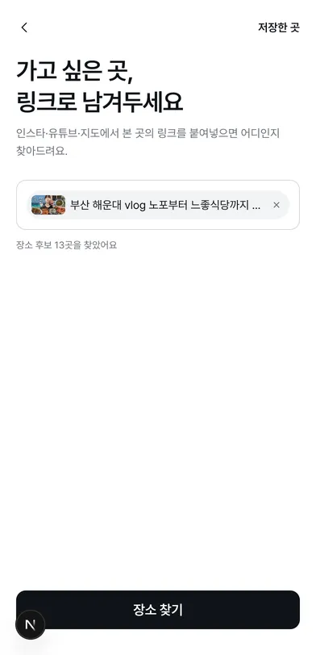
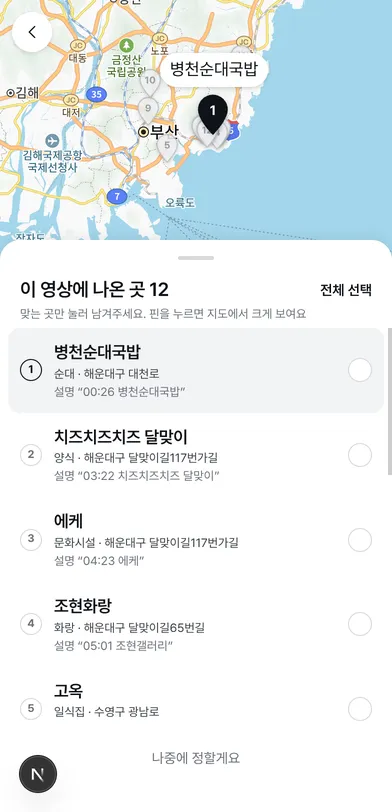
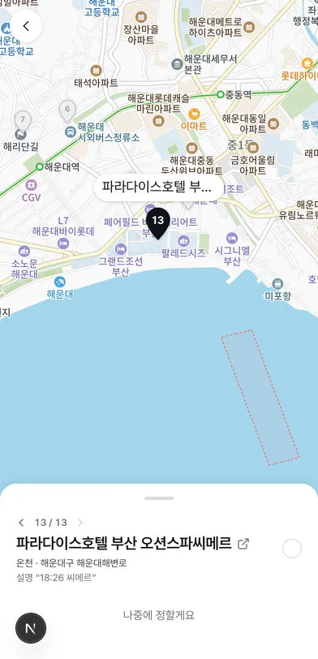
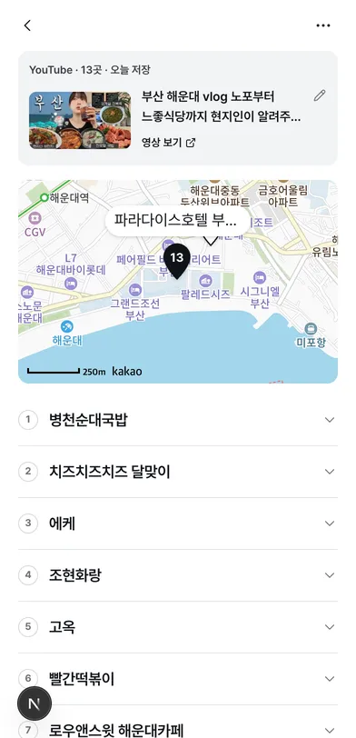

# FE-FEAT-019 링크 저장 실험 — YouTube 표본 실측

- 일시: 2026-10-29 · 표본: 부산 여행 YouTube 19건(가게 위주 · 관광지 위주 · 쇼츠 · 영어 영상 포함)
- 대상 코드: `src/lib/linkClues.ts` · `src/app/api/link-resolve/route.ts` — 설명란 · 제목 단서 → 카카오 로컬 키워드 검색(부산 주소만, 주거시설 제외). 링크당 단서 30건 · 후보 30곳까지
- 판정 기준: 설명란 · 제목의 단서와 카카오가 돌려준 가게 이름 · 동네가 같은 곳인지. **영상을 재생해 대조하지 않았다.** ✓ 같은 곳 · △ 이름은 맞지만 다른 지점일 수 있음 · ✗ 다른 곳
- 재현: `/api/link-resolve?url=https://youtu.be/{id}`

## 요약

| 항목 | 값 |
|---|---|
| 후보가 1곳 이상 나온 영상 | 16 / 19 |
| 후보 수 | 157 |
| ✓ / △ / ✗ | 138 / 13 / 6 |
| 처음부터 선택되는 후보(`📍` · 목록 · 번호 줄) | 53 — 이 중 ✗ 1 · △ 1 |
| 후보 0 | 3건 — 설명란 · 제목에 장소가 없다(장소는 영상 안에만) |
| 같은 영상 다른 주소(`youtu.be/…?si=` · `watch?v=…&t=`) | 한 링크로 저장됨(덮어쓰기) |

## 화면

| ① 링크 분석 완료 | ② 후보 — 지도 + 목록 | ③ 마커 → 접힌 카드 |
|---|---|---|
|  |  |  |
| 타임라인 15줄 영상(XOwYsXjZ8zw) → "장소 후보 13곳" | 타임스탬프 후보는 처음에 선택 안 됨 | 13번 "씨메르" → 오션스파씨메르 |

| ④ 저장한 링크 목록 | ⑤ 영상 상세 — 장소 펼침 |
|---|---|
|  |  |
| 영상 5개 저장(같은 영상 두 주소는 하나로) | 13번 줄을 누르면 지도가 그 곳으로 |

## 브라우저 저장 테스트

로컬 개발 서버(Chrome)에서 링크 붙여넣기 → 장소 찾기 → 저장 순서로 8개 영상을 저장했다.
처음 선택이 있는 영상은 그대로, 처음 선택이 없는 영상(타임스탬프 · 제목 단서뿐)은 후보를 모두 골라 저장했다.

| 영상 | 단서 | 처음 선택 | 저장 |
|---|---|---|---|
| LK-Qc3NpqRc | 번호 줄 | 6 / 6 | 6곳 |
| PIk0mw-x6hg | `📍이름 00:42` | 6 / 6 | 6곳 |
| lLmHK1y0ZVQ | `📍설명 \| 이름` | 8 / 8 | 8곳 |
| izp9Vn3ZNGM | `📍` 아래 목록 | 4 / 4 | 4곳 |
| sHxIbAf-n1s | `ㄴ` 목록 | 8 / 8 → 한도 상향 후 16 / 18 | 8곳 → 16곳 |
| XOwYsXjZ8zw | 타임스탬프 15줄 | 0 / 8 → 한도 상향 후 0 / 13 | 모두 골라 8곳 → 13곳 |
| UeHR5n8H3xc | 제목 괄호 | 0 / 5 | 모두 골라 5곳 |
| Iz5e1otF0PE | 영어 타임스탬프 48줄 | 0 / 6 → 한도 상향 후 0 / 20 | 모두 골라 6곳 → 20곳 |

- 이 테스트에서 링크당 후보 8곳 한도가 실제 영상에 비해 작았다(타임라인 15줄 영상이 8곳만 저장). 단서 30건 · 후보 30곳으로 올렸다.
- 같은 영상이 `?v=…` · `?v=…&feature=youtu.be` 두 주소로 따로 저장됐다. YouTube 는 `https://www.youtube.com/watch?v={id}` 한 주소로 맞춘다.

## 단서 종류별

| 종류 | 예 | 결과 |
|---|---|---|
| `📍` · 목록 · 번호 줄 (`pin`) | `📍바우하우스 00:42`, `ㄴ해동용궁사 https://place.map.kakao.com/…`, `1. 호돌이초장집` | 40곳 중 ✗ 1(동명 다른 지점) · △ 1 |
| 타임스탬프 줄 (`stamp`) | `01:09 송정원가야 밀면`, `01:38 Busan Station` | 영어 이름도 찾는다. 객실 · 시설 · 일반 챕터("스위트룸" · "수영장" · "밀면식당" · "광안리 빵지순례")가 ✗ 대부분 |
| 제목 목록 (`title`) | `(이재모•신발원만두•…)`, `\| 해목, 비비비당, 신발원`, `ㅣ돼지국밥, 연화리해녀촌` | 설명란이 빈 영상 3건을 살렸다. 음식 이름("떡볶이")은 가게 이름 필터로 빠진다 |
| 해시태그 (`tag`) | `#해동용궁사`, `#광안리` | 일반어(`#부산맛집` · `#힐링스팟`)는 단서에서 뺀다 — 카카오에 그 이름의 가게가 실제로 있다 |

## 영상별

| 영상 | 단서 | 후보 | ✗ · △ |
|---|---|---|---|
| izp9Vn3ZNGM 부산 하루 코스 | `📍` 아래 `-` 목록 | 4 | — |
| sHxIbAf-n1s 2박3일 Vlog | `ㄴ` 목록 + 타임스탬프 | 17 | △ 초량밀면("부산 밀면") |
| R6kdwCzwm6k 드론 2박3일 | 타임스탬프 | 19 | ✗ 드론쇼코리아("광안리 드론쇼") |
| kwiLbBRMMzA 사찰투어 | 해시태그 | 1 | — |
| h4WN4S1TK7k 힐링 1박2일 | 타임스탬프 · 제목(`ㅣ`) · 해시태그 | 6 | △ 연화리해녀촌 제주부씨(해녀촌의 한 가게) · △ 부산렌트카(`#부산렌트카`) |
| 1_i7SjsSaqc 당일치기 7곳 | 없음 | 0 | — |
| FgdEjj3CnC8 맛집 BEST 7 | 일반어 해시태그뿐 | 0 | — |
| Q94WLbRsWgQ 2박3일 브이로그 | 없음 | 0 | — |
| XOwYsXjZ8zw 해운대 로컬 맛집 | 타임스탬프 15줄 | 12 | △ 고옥 · 초원복국 · 모모스커피(지점). 미검색 3 — 더반베를린 · 기장해녀촌 0번정해집(카카오에 그 이름 없음) · 해운대 러닝코스 |
| UeHR5n8H3xc 영도투어 | 제목 괄호 | 5 | △ 카페미미(지점) |
| LK-Qc3NpqRc 맛집 Best6 | 번호 줄 | 6 | — |
| 0FXFnagUOZk 먹부림 1박2일 | 제목 `\|` 목록 | 5 | — |
| sUTjcaiRtOA 맛집 12곳 · 호텔 | 타임스탬프 | 16 | ✗ 사직 실내수영장("수영장") · 초량밀면("밀면식당") · 경주집("경주") |
| Hy2bYYzyZhs 1박2일 뚜벅이 | 타임스탬프 · 해시태그 | 11 | △ 두루미 전포점 · 자갈치횟집(지점). "부산타워" 는 이름이 겹치지 않아 빠짐 |
| Iz5e1otF0PE 4 Days in Busan (영어) | 영어 타임스탬프 | 20 | ✗ 피오또("ECKE") · △ 이재모피자 광복배달포장점 · 큐("KEW") · 산("SAAN") |
| PIk0mw-x6hg 광안리 vlog | `📍이름 00:42` | 6 | △ 바우하우스(사진관으로 잡힘) |
| lLmHK1y0ZVQ 쇼츠 뚜벅이 | `📍설명 \| 이름` | 8 | ✗ 베이스먼트(금정구 동명 가게) |
| OWu7Uo_OFxo 해운대 · 광안리 | 제목 `\|` 목록 · 해시태그 | 8 | — |
| KZKOar4HmuA 시티투어버스 (쇼츠) | 원 숫자 목록 `① 부산역(출발)` | 13 | — (정류장 14곳 중 "광복로" 는 거리 이름이라 빠짐) |

## 표본으로 바뀐 규칙

| 표본 | 바뀐 규칙 |
|---|---|
| LK-Qc3NpqRc | `1. 가게명` 아래 `📍` 가 오면 번호 줄이 이름. `📍부산 ○○구 …` 주소 줄은 이름이 아니다. `📍` 다음 줄이 ⏰ · 💸 같은 정보 줄이면 그 `📍` 은 머리줄이 아니다 |
| PIk0mw-x6hg | 이름 앞뒤 타임스탬프를 뗀다 |
| lLmHK1y0ZVQ | `📍설명 \| 이름` 은 뒤가 이름. `@계정` 표기를 뗀다 |
| UeHR5n8H3xc · 0FXFnagUOZk · h4WN4S1TK7k | 제목의 괄호 · `\|` · `ㅣ` 뒤 목록을 단서로(`title`). 처음에는 선택 안 함 |
| Hy2bYYzyZhs | "시작" 을 챕터 단어로 |
| FgdEjj3CnC8 · kwiLbBRMMzA 등 | 일반어 해시태그 · 제목 단서 제외(맛집 · 여행 · 스팟 …) |
| XOwYsXjZ8zw | 링크당 단서 30건 · 후보 30곳. 카카오 결과 중 주거시설(빌라 · 주택)은 건너뛴다("씨메르" → 오션스파씨메르) |
| izp9Vn3ZNGM | 주소가 부산인 결과만("롯데 프리미엄 아울렛" → 김해점 제외). YouTube 주소를 `watch?v={id}` 로 맞춰 중복 저장을 막는다 |
| KZKOar4HmuA | 원 숫자 줄(①~⑳)을 장소 줄로. 별표 설명(`*기간한정 무정차`) 제거, 쉼표로 여러 곳이면 나눔, 괄호 안이 장소면 괄호 안 이름(`마린시티(수영만 요트경기장)`) |
| 전체 | 단서와 가게 이름이 두 글자도 겹치지 않으면 버린다("광복로" → 올리브영, "스위트룸" → 고시텔). 영어 단서는 제외 |

## 남은 한계

| 한계 | 표본 | 다음 후보 |
|---|---|---|
| 동명 다른 지점 — 카카오 첫 결과가 다른 동네 | 베이스먼트(금정구), 고옥 · 카페미미 · 자갈치횟집 | 같은 영상의 다른 후보 근처로 좁혀 다시 검색(카카오 `x` · `y` · `radius`) |
| 장소가 아닌 챕터 | 수영장 · 밀면식당 · 경주 | 이름 겹침 규칙으로 대부분 빠졌다. 남은 것은 처음 선택에서 빠져 있어 사용자가 고르지 않으면 저장되지 않는다. 카카오 업종 그룹(숙박 · 체육시설)으로 더 거를 수 있다 |
| 카카오에 없는 이름 | 더반베를린 · 기장해녀촌 0번정해집 | 직접 찾기 · 이름만 적어두기 |
| 장소가 영상 안에만 있음 | 3건 | 자막은 영상 주인 OAuth 가 필요해 공식 경로로 읽을 수 없다(DOCS-002) — 직접 찾기로 |
| 카카오 호출 수 | 링크당 최대 30건 | 일일 무료 쿼터 수치 확인 필요(결정 기록 "남은 확인") |
